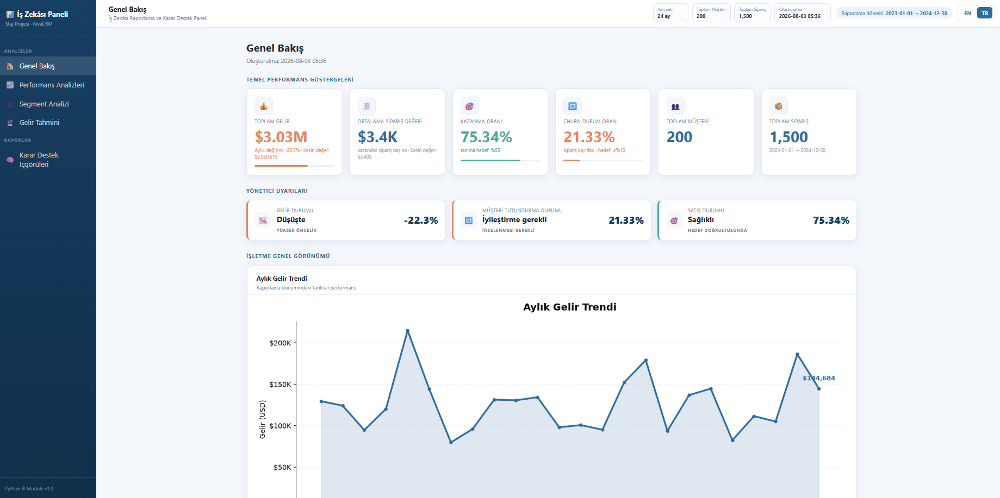
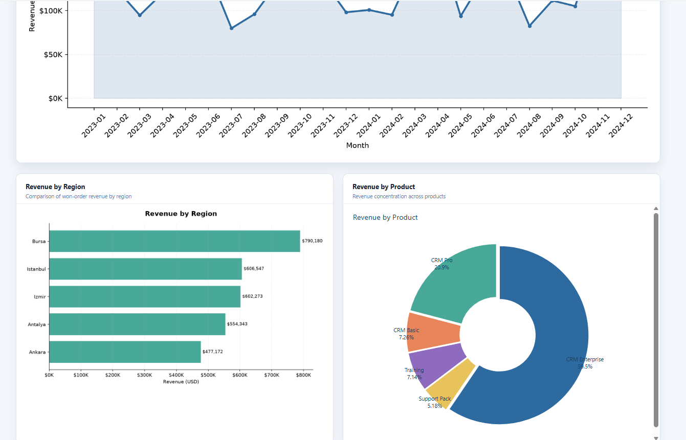
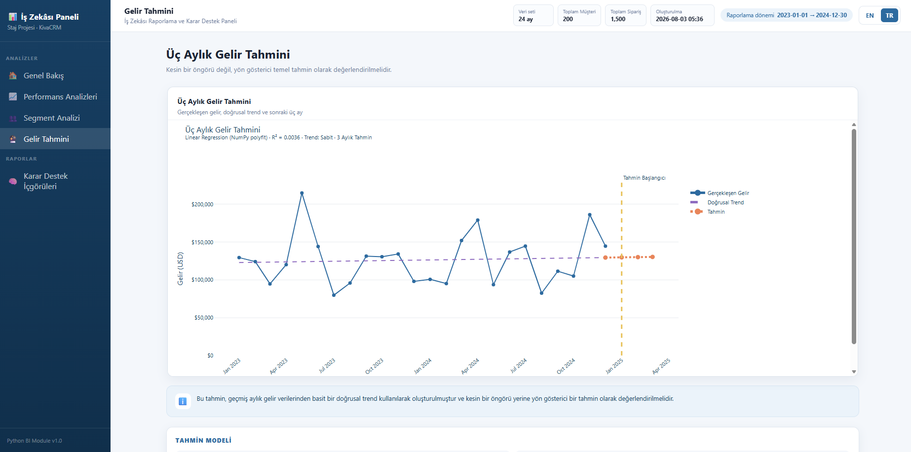
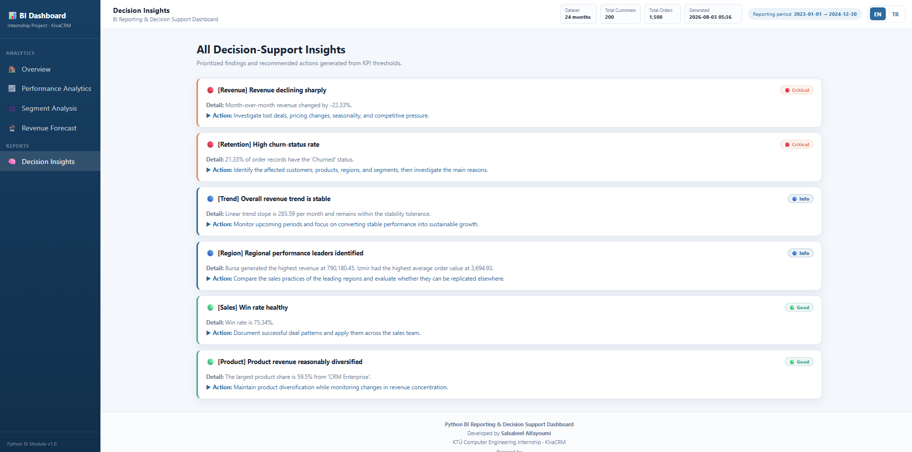
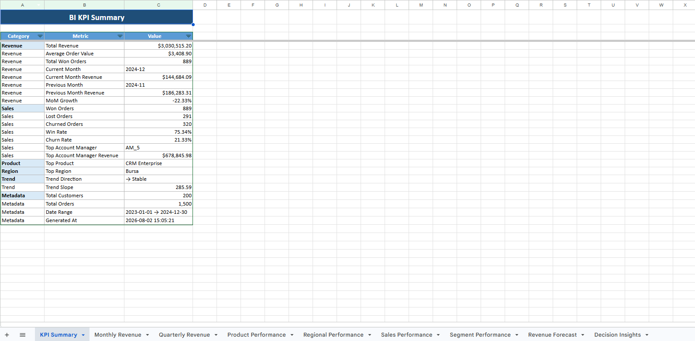
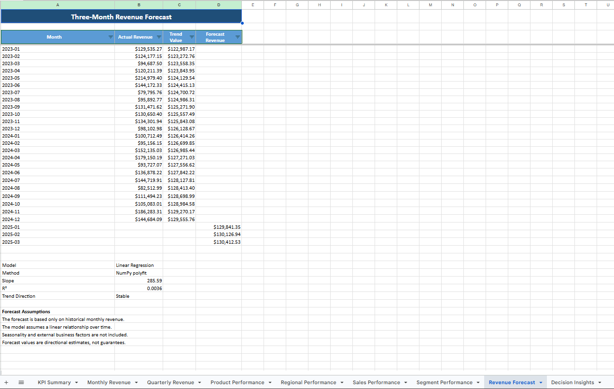

# Python BI Reporting & Decision Support System

A modular **Business Intelligence (BI)** and **Decision Support System** developed in Python as part of my **Software Engineering Internship at KivaCRM**.

The system analyzes CRM sales data, validates data quality, calculates key business performance indicators (KPIs), performs customer segment analysis, generates revenue forecasts, produces automated business recommendations, and creates bilingual reports in both **English** and **Turkish**.

The project runs entirely on a local machine and requires no cloud services or paid APIs.

---

# Features

## Data Processing

- Synthetic CRM dataset generator
- Automated data validation
- Dataset health report
- CSV-based data pipeline
- Duplicate and missing-value detection
- Invalid data validation (dates, quantities, statuses, revenue)

## KPI Engine

Automatically calculates business metrics including:

- Total Revenue
- Average Order Value
- Month-over-Month (MoM) Revenue Growth
- Win Rate
- Churn Rate
- Product Performance
- Regional Performance
- Sales Performance
- Revenue Trend Analysis

## Customer Segment Analysis

Compares customer segments using:

- Total Revenue
- Revenue Share
- Revenue per Customer
- Average Order Value
- Win Rate
- Churn Rate
- Active Customers
- Best Performing Product

## Revenue Forecasting

Forecasts the next three months using Linear Regression (NumPy Polyfit).

The forecast includes:

- Historical monthly revenue
- Trend line
- Forecast values
- Monthly slope
- R² (coefficient of determination)
- Forecast assumptions

## Decision Support Engine

A rule-based decision support engine automatically evaluates KPI results and generates business recommendations.

The engine identifies situations such as:

- Revenue decline
- High churn
- Sales performance
- Regional performance
- Product concentration
- Business trend

Each insight contains:

- Severity level
- Business explanation
- Recommended action

## Reporting

The system automatically generates:

- Interactive HTML Dashboard
- Excel KPI Report
- Decision Support Report
- Console Summary

## Bilingual Support

Every dashboard page and report is available in:

- 🇬🇧 English
- 🇹🇷 Turkish

---

# Dashboard Preview

## Overview



---

## Business Analytics



---

## Revenue Forecast



---

## Decision Support



---

# Excel Reports

## KPI Summary



---

## Revenue Forecast



---

# Technologies

- Python
- Pandas
- NumPy
- Matplotlib
- Plotly
- OpenPyXL
- HTML
- CSS

---

# Project Structure

```text
Python-BI-Reporting-System/
│
├── data/
│   ├── customers.csv
│   ├── orders.csv
│   └── generate_data.py
│
├── modules/
│   ├── data_analysis.py
│   ├── decision_support.py
│   ├── excel_exporter.py
│   ├── forecast.py
│   ├── i18n.py
│   ├── kpi_engine.py
│   ├── report_generator.py
│   ├── segment_analysis.py
│   ├── visualizer.py
│   └── __init__.py
│
├── reports/
│   ├── dashboard.html
│   ├── kpi_report.xlsx
│   └── charts/
│
├── screenshots/
│
├── main.py
├── requirements.txt
├── README.md
└── Internship_Build_Plan.md
```

---

# Installation

Clone the repository:

```bash
git clone https://github.com/<your-username>/<repository-name>.git
```

Install the required packages:

```bash
pip install -r requirements.txt
```

Generate the synthetic dataset (only once):

```bash
python data/generate_data.py
```

Run the complete pipeline:

```bash
python main.py
```

---

# Workflow

The application executes the following pipeline:

```text
Load CRM Data
        │
        ▼
Validate Dataset
        │
        ▼
Compute KPIs
        │
        ▼
Customer Segment Analysis
        │
        ▼
Revenue Forecasting
        │
        ▼
Generate Charts
        │
        ▼
Decision Support Analysis
        │
        ▼
Generate HTML Dashboard
        │
        ▼
Generate Excel Report
```

---

# Generated Outputs

Running the project automatically creates:

```text
reports/
│
├── dashboard.html
├── kpi_report.xlsx
└── charts/
```

The HTML dashboard contains:

- Executive KPI Overview
- Monthly Revenue Analysis
- Regional Performance
- Product Performance
- Customer Segment Analysis
- Revenue Forecast
- Decision Support Insights

---

# Future Improvements

Possible future extensions include:

- Database integration
- REST API
- Machine Learning forecasting models
- Streamlit dashboard
- PDF report generation
- User authentication
- Advanced forecasting algorithms
- CLI filtering options
- Real-time CRM integration

---

# Internship

This project was developed during my **Software Engineering Internship at KivaCRM**.

The original internship roadmap is available in:

```
Internship_Build_Plan.md
```

The final implementation extends the original roadmap with several additional features, including:

- Customer Segment Analysis
- Revenue Forecasting
- Excel Report Export
- Bilingual Reporting (English & Turkish)
- Data Validation Module
- Enhanced Dashboard Design
- Interactive Plotly Visualizations

---

# Author

**Salsabeel Alfayoumi**

Computer Engineer

Software Engineering • Python • Data Analysis • Business Intelligence • Decision Support Systems